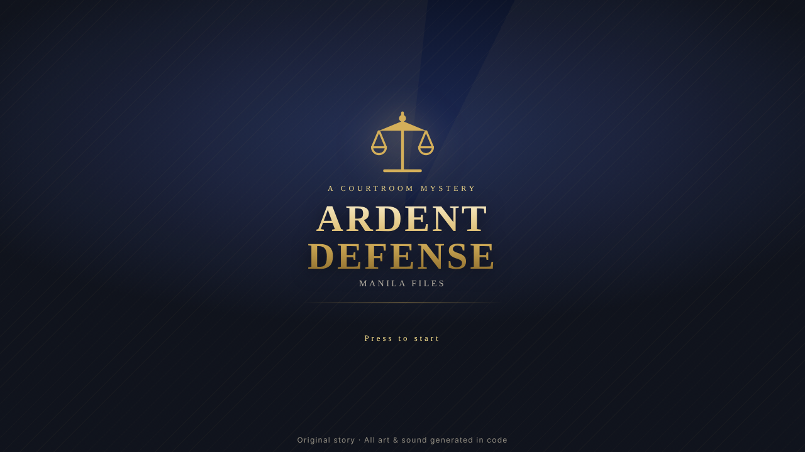
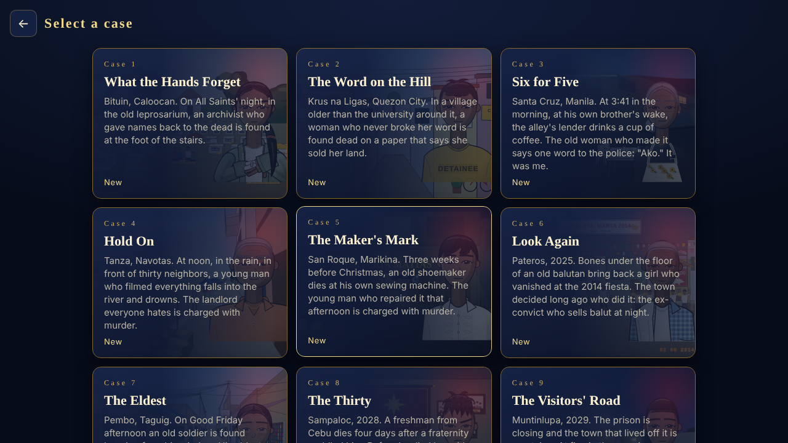
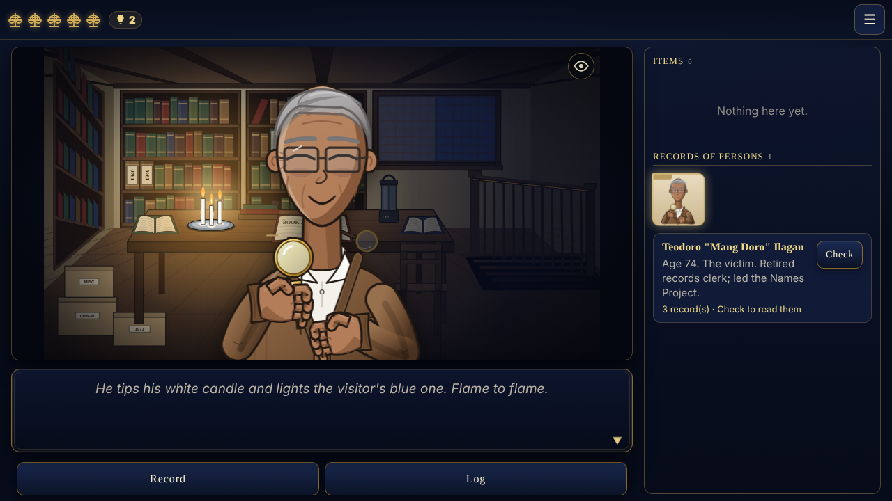

# Ardent Defense: Manila

**A courtroom mystery for the browser.** You are Kai Ardent, a rookie defense attorney in Metro Manila. Each case is a new neighborhood, a new death, and a client the town has already decided is guilty. Your job is to find out what really happened and prove it in court.

## The story

Twelve original cases, each standing on its own, set across Manila and its neighbors: Caloocan, Quezon City, Santa Cruz, Navotas, Marikina, Pateros, Taguig, Sampaloc, Muntinlupa and Pasig. They deal with grief, debt, family, loyalty and the stories a community tells itself. Everything in the game is original, including the art and the sound.

## How to play

Each case moves between three kinds of scenes.

- **Investigate.** Visit places, talk to people, look at objects, and collect evidence. Everything you gather goes into your **Court Record**, along with profiles of the people involved.
- **Cross-examine.** In court, a witness gives testimony one statement at a time. Read it carefully. Use **Press** to ask for more detail, and **Present** evidence when a statement contradicts something you know. Somewhere in every testimony, a lie is waiting to be found.
- **Decide.** Some moments ask you to pick a response, present the right item, or point to the right spot. Time pressure can apply, so read quickly but think first.

### Staying in the fight

- **Credibility** (the scales at the top left) is your health. A wrong accusation costs you one. Lose them all and the case is lost.
- **Insight** (the lightbulb) buys you hints when you're stuck.
- Open the **Court Record** at any time to review evidence and profiles. Check the Log to reread earlier dialogue.

### Controls

| Action | Touch | Mouse | Keyboard |
|---|---|---|---|
| Next line | Tap the text box | Click | Space / Enter |
| Previous / next statement | ◀ ▶ or swipe | Click | ← → |
| Press | Press button | Click | P |
| Present evidence | Present button | Court Record panel | E |
| Court Record | Record button | Side panel | R |
| Hint | Hint button | Click | H |
| Log | Log button | Click | L |
| Close | ✕ | Click outside | Esc |

It plays on phones, tablets and desktops. Progress saves automatically, so you can come back with **Continue**. The Settings menu lets you change text speed, music and sound volume, screen shake, and how much time pressure you want (from Intense to Off).

## License
© 2026 King James Villasin. Licensed under CC BY-NC-ND 4.0 (https://creativecommons.org/licenses/by-nc-nd/4.0/). See LICENSE.
